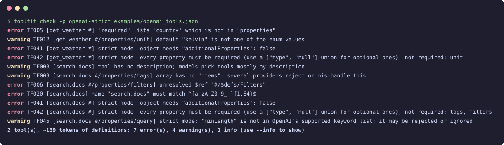

# toolfit

[](https://github.com/Yi-111-a/toolfit/actions/workflows/ci.yml)


[](LICENSE)

**Lint LLM tool / function-calling schemas before the API rejects them.**

You write a tool once, then ship it to OpenAI, Anthropic, DeepSeek or expose it through an MCP server — and
find out at runtime that `search.docs` is not a legal function name, that strict mode wants
`"additionalProperties": false` on *every* nested object, that `required` mentions a field you renamed last week,
or that one bloated tool costs you 900 tokens on every single request.

`toolfit` is a zero-dependency CLI (and Python library) that catches these problems in CI, and can
**auto-rewrite schemas for OpenAI strict mode**.



## Install

```bash
pip install git+https://github.com/Yi-111-a/toolfit
# or, from a clone
pip install .
```

Python 3.9+, no runtime dependencies.

## Usage

```bash
# provider-neutral hygiene checks
toolfit check tools.json

# check against one or more providers
toolfit check -p openai-strict -p anthropic tools.json

# lint what your MCP server actually advertises
npx @modelcontextprotocol/inspector --cli node server.js --method tools/list > tools.json
toolfit check -p mcp tools.json

# make schemas strict-mode compatible (adds additionalProperties:false, makes optional fields nullable)
toolfit fix tools.json -o tools.strict.json
toolfit fix tools.json --in-place

# machine-readable output / GitHub annotations
toolfit check -f json tools.json
toolfit check -f github -p openai tools.json

toolfit profiles   # list profiles
```

Exit codes: `0` clean, `1` issues at or above `--fail-on` (default `error`; also `warning`, `info`, `never`),
`2` unreadable input.

### Accepted input (auto-detected)

| Shape | Example |
| --- | --- |
| OpenAI Chat Completions | `[{"type": "function", "function": {"name", "description", "parameters"}}]` |
| OpenAI Responses API | `[{"type": "function", "name", "description", "parameters"}]` |
| Anthropic Messages | `[{"name", "description", "input_schema"}]` |
| MCP `tools/list` result or raw JSON-RPC response | `{"tools": [{"name", "description", "inputSchema"}]}` |
| Full request body | `{"model": "...", "messages": [...], "tools": [...]}` |
| Bare JSON Schema | `{"type": "object", "properties": {...}}` |

## Profiles and rules

| Profile | What it adds |
| --- | --- |
| `generic` | always-on hygiene checks (below) |
| `openai` | name must match `^[a-zA-Z0-9_-]{1,64}$`; at most 128 tools per request |
| `openai-strict` | `openai` + Structured Outputs constraints |
| `anthropic` | name must match `^[a-zA-Z0-9_-]{1,64}$` |
| `deepseek` | same as `openai` (DeepSeek's API is OpenAI-compatible) |
| `mcp` | MCP name guidance (`[A-Za-z0-9_.-]{1,128}`) plus a portability warning for names LLM APIs will reject |

| Code | Severity | Rule |
| --- | --- | --- |
| TF001 / TF002 | error | missing / duplicate tool name |
| TF003 | warning | tool has no description |
| TF004 | info | parameter has no description |
| TF005 | error | `required` lists a property that does not exist |
| TF006 | error | unresolved local `$ref` |
| TF007 | error | invalid JSON Schema `type` (e.g. `"str"`) |
| TF008 | error | empty `enum` |
| TF009 | warning | array without `items` |
| TF010 | error | root parameters schema is not `type: object` |
| TF011 | info | definition larger than `--token-budget` (~4 chars/token estimate) |
| TF012 | warning | `default` not in `enum` |
| TF020 | error | name not accepted by OpenAI / Anthropic / DeepSeek |
| TF021 / TF022 | warning | MCP name outside spec guidance / not portable to LLM APIs |
| TF030 | error | more than 128 tools |
| TF040 – TF046 | error/warning | strict mode: root `anyOf`, missing `additionalProperties: false`, non-required properties, nesting > 10, unsupported keywords (`allOf`, `not`, `if/then/else`, `patternProperties`, …), `minLength`/`maxLength`, > 5000 properties |

Provider limits change; the rules encode the documented limits as of late 2026. Issues and PRs with updated
limits are very welcome.

### What `toolfit fix` does

```jsonc
// before                                  // after
"properties": {                            "properties": {
  "city": {"type": "string"},                "city": {"type": "string"},
  "unit": {"type": "string",                 "unit": {"type": ["string", "null"],
           "enum": ["c", "f"]}                        "enum": ["c", "f", null]}
},                                         },
"required": ["city"]                       "required": ["city", "unit"],
                                           "additionalProperties": false
```

It applies recursively (nested objects, `items`, `anyOf`, `$defs`), wraps optional `$ref`s in
`anyOf: [ref, {"type": "null"}]`, drops `required` entries that point at nothing, and sets `"strict": true`
on OpenAI-shaped tools (disable with `--no-strict-flag`). The input file is never modified unless you pass
`--in-place`.

## Use in CI

```yaml
- run: pip install git+https://github.com/Yi-111-a/toolfit
- run: toolfit check -f github -p openai-strict -p mcp tools/*.json
```

`-f github` turns findings into inline annotations on the pull request.

## Library

```python
import json
from toolfit import load_tools, check_tools, make_strict

tools = load_tools(json.load(open("tools.json")))
for issue in check_tools(tools, ["openai-strict"]):
    print(issue.severity, issue.code, issue.tool, issue.message)

strict_schema = make_strict(tools[0].schema)
```

## 中文说明

`toolfit` 是一个零依赖的命令行工具，用来在上线前检查大模型工具调用（function calling / tool use）的 JSON Schema，
支持 OpenAI（含 strict 结构化输出模式）、Anthropic、DeepSeek 以及 MCP 服务器的 `tools/list` 输出。
它能发现非法工具名（比如带点号的 `search.docs`）、`required` 里引用了不存在的字段、未解析的 `$ref`、
strict 模式缺少 `additionalProperties: false` 等问题，并估算每个工具定义消耗的 token。
`toolfit fix` 可以一键把 schema 改写成 OpenAI strict 模式兼容的形式。适合放进 CI，`-f github` 会在 PR 上生成行内注释。

```bash
pip install git+https://github.com/Yi-111-a/toolfit
toolfit check -p openai-strict -p deepseek tools.json
toolfit fix tools.json -o tools.strict.json
```

## License

[MIT](LICENSE)
